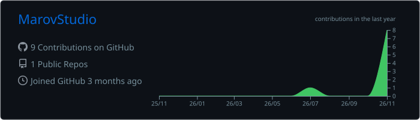
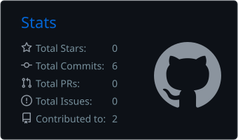
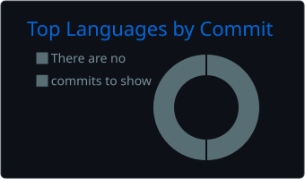
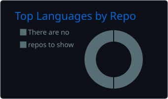
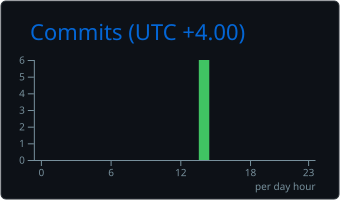

<p align="center">
  
</p>

<p align="center">
  <a href="https://github.com/MarovStudio">
    
  </a>
</p>

<p align="center">
  
  
  
  
</p>

<br/>

<table>
<tr>
<td width="58%" valign="top">

### `> whoami`

```ts
const marov = {
  role:      "Founder & Lead Engineer",
  studio:    "MarovStudio",
  building:  ["SaaS platforms", "E-commerce automation", "Desktop apps"],
  stack:     ["TypeScript", "Next.js", "Node.js", "C#/.NET", "Python"],
  infra:     ["Linux VPS", "Docker", "Nginx", "GitHub Actions"],
  education: "Eshipx — e-commerce courses",
  languages: ["Azərbaycan", "English"],
  motto:     "Ship it, measure it, make it better.",
};
```

</td>
<td width="42%" valign="top">

### `> focus`

- 🧩 **Product engineering** — idea → MVP → production
- 🛒 **E-commerce tooling** — seller automation, listings, analytics
- ⚙️ **Automation** — bots, scrapers, CI/CD pipelines
- 🖥️ **Desktop** — Windows apps with .NET / WPF
- 🌐 **Web** — fast, SEO-friendly, multilingual sites

</td>
</tr>
</table>

<br/>

## 🛠️ Arsenal

<table align="center">
<tr><td><b>Frontend</b></td><td>


</td></tr>
<tr><td><b>Backend</b></td><td>


</td></tr>
<tr><td><b>Data</b></td><td>


</td></tr>
<tr><td><b>DevOps</b></td><td>


</td></tr>
<tr><td><b>Tools</b></td><td>


</td></tr>
</table>

<br/>

## 📈 Engineering Metrics

<p align="center">
  
</p>
<p align="center">
  
  
</p>
<p align="center">
  
  
</p>
<p align="center">
  
</p>

<br/>

## 🚀 Open Source

<table align="center">
<tr>
<td width="100%">

#### 🎮 [couchsubs](https://github.com/MarovStudio/couchsubs) &nbsp;  
Real-time PS5 subtitle translation — added a **phone-screen mode** so subtitles can be shown on any phone browser instead of a smart-TV app.

</td>
</tr>
</table>

<p align="center"><sub>🔒 Most of my commercial work lives in private repositories.</sub></p>

<br/>

## 🐍 Contribution Activity

<p align="center">
  <picture>
    <source media="(prefers-color-scheme: dark)" srcset="https://raw.githubusercontent.com/MarovStudio/MarovStudio/output/github-snake-dark.svg" />
    <source media="(prefers-color-scheme: light)" srcset="https://raw.githubusercontent.com/MarovStudio/MarovStudio/output/github-snake.svg" />
    
  </picture>
</p>

<p align="center">
  
</p>
